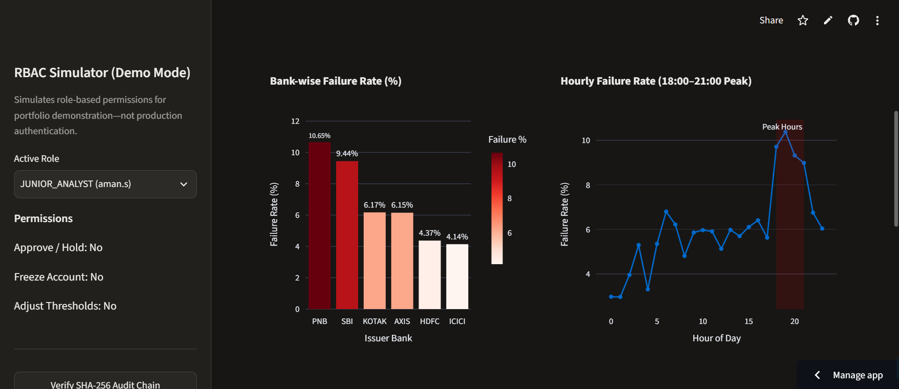
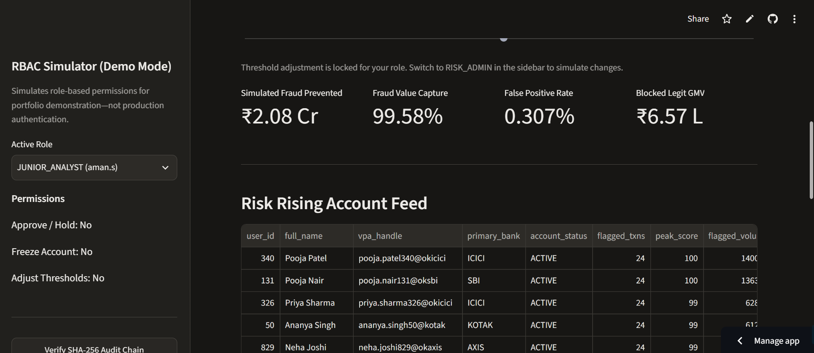

# UPI Payment Operations & Fraud Risk Monitor

Interactive Streamlit monitor for UPI payment funnel diagnostics, issuer bank failure/GMV analysis, hybrid fraud scoring, RBAC permission simulation, and SHA-256 hash-chained audit verification.

## Dashboard Preview

## Methodology & Limitations

- **Synthetic Dataset:** All 50,000 UPI transactions across 1,000 accounts (with a 3.00% injected fraud rate) are synthetically generated for portfolio demonstration and do not contain real customer or bank data.
- **Rules-Based / Simulated Fraud Labels:** Fraud labels and risk tiers are simulated/rules-driven rather than sourced from ground-truth bank chargebacks or confirmed dispute ledgers.
- **Out-of-Fold Evaluation & Unsupervised Scoring:** `IsolationForest` is an unsupervised anomaly detector, and ML/hybrid scoring is evaluated using 5-fold stratified out-of-fold (`oof_score`) splits across the 50,000 simulated transactions rather than relying purely on in-sample fits.
- **Demo-Mode RBAC Controls:** Role switching (`JUNIOR_ANALYST`, `FRAUD_OPS`, `RISK_ADMIN`) in the sidebar simulates permission gating for demonstration purposes only and is not production authentication or identity management.

## Dashboard Preview

